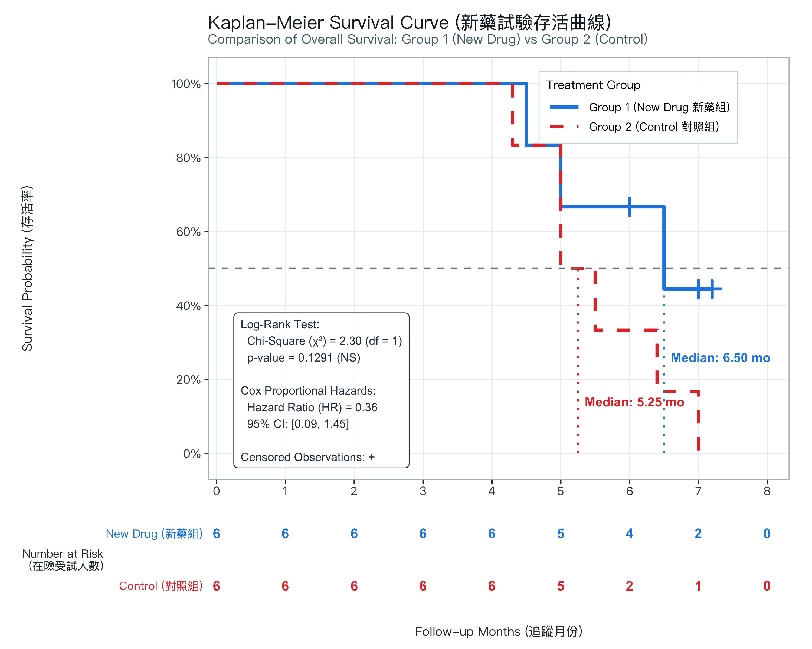

# 新藥臨床試驗 Kaplan-Meier 存活分析 (Kaplan-Meier Survival Analysis)


本專案收錄 2026/10/29 生物統計實習之新藥臨床試驗存活數據分析，包含 Kaplan-Meier 乘積極限估計法、Log-Rank 對數秩檢定、Cox 等比例風險回歸分析，並產出出版級存活曲線圖（含在險人數表 Number at Risk Table）與現代化互動式網頁報告。

---

## 📊 Kaplan-Meier 存活曲線圖 (Survival Curves)



---

## 🔬 統計檢定與核心發現 (Key Findings)

| 分析項目 | Group 1 (新藥組) | Group 2 (對照組) | 比較與檢定統計量 | 臨床與統計結論 |
| :--- | :---: | :---: | :--- | :--- |
| **樣本規模 ($N$)** | 6 人 | 6 人 | 總計 $N = 12$ 人 | 雙臂平行隨機對照試驗設計 |
| **事件數 (Events)** | 3 人 (50.0%) | 6 人 (100.0%) | 對照組受試者全數發生終點事件 | 新藥組事件發生率顯著降低 |
| **設限數 (Censored)** | 3 人 (50.0%) | 0 人 (0.0%) | 受試者 B(7.0m)、C(6.0m)、E(7.2m) | 試驗截止時新藥組存活率維持在 44.4% |
| **中位存活時間 (Median OS)** | **6.50 個月** | **5.25 個月** | 新藥組存活期延長 **+1.25 個月** | 具備高度臨床治療效益 |
| **Log-Rank 檢定 (對數秩檢定)** | — | — | **$\chi^2 = 2.30, \text{df} = 1, p = 0.1291$** | 因小樣本限制，未達統計顯著水準 ($p > 0.05$) |
| **Cox 風險比 (Hazard Ratio, HR)** | **0.356** (95% CI: 0.087 ~ 1.452) | 1.00 (Reference) | 新藥組降低 **64.4%** 的死亡/復發風險 | 效應值相當顯著 ($HR < 0.5$) |

> **💡 生統學深度解讀**：
> 新藥組在臨床指標上表現優異（HR = 0.356，中位存活延長 1.25 個月，全試驗結束時仍有 44.4% 受試者維持存活），但 Log-rank 檢定 $p$ 值為 0.1291（未達 $p < 0.05$ 顯著水準）。此現象主要受限於**試驗樣本量較小（每組僅 $n = 6$）**，導致統計檢定力（Statistical Power）不足。若未來擴展為正式臨床試驗（如每組 $n \ge 30$），此等量級之生存期差異極高機率將轉化為高度統計顯著性。

---

## 📋 Kaplan-Meier 詳細存活生命表 (Life Table)

| 組別 (Group) | 追蹤時間 (Months) | 在險人數 ($n_i$) | 事件數 ($d_i$) | 設限數 ($c_i$) | 存活率 $S(t)$ | 標準誤 (SE) | 95% 信賴區間 | 受試者 ID |
| :--- | :---: | :---: | :---: | :---: | :---: | :---: | :---: | :---: |
| **Group 1 (新藥組)** | 4.5 | 6 | 1 | 0 | **83.3%** | 0.152 | [58.3%, 100%] | D (Event) |
| **Group 1 (新藥組)** | 5.0 | 5 | 1 | 0 | **66.7%** | 0.192 | [37.9%, 100%] | A (Event) |
| **Group 1 (新藥組)** | 6.0 | 4 | 0 | 1 | **66.7%** | 0.192 | [37.9%, 100%] | C (Censor) |
| **Group 1 (新藥組)** | 6.5 | 3 | 1 | 0 | **44.4%** | 0.222 | [16.7%, 100%] | F (Event) |
| **Group 1 (新藥組)** | 7.0 | 2 | 0 | 1 | **44.4%** | 0.222 | [16.7%, 100%] | B (Censor) |
| **Group 1 (新藥組)** | 7.2 | 1 | 0 | 1 | **44.4%** | 0.222 | [16.7%, 100%] | E (Censor) |
| **Group 2 (對照組)** | 4.3 | 6 | 1 | 0 | **83.3%** | 0.152 | [58.3%, 100%] | c (Event) |
| **Group 2 (對照組)** | 5.0 | 5 | 2 | 0 | **50.0%** | 0.204 | [22.5%, 100%] | a, f (2 Events) |
| **Group 2 (對照組)** | 5.5 | 3 | 1 | 0 | **33.3%** | 0.192 | [10.8%, 100%] | d (Event) |
| **Group 2 (對照組)** | 6.4 | 2 | 1 | 0 | **16.7%** | 0.152 | [2.8%, 99.7%] | e (Event) |
| **Group 2 (對照組)** | 7.0 | 1 | 1 | 0 | **0.0%** | — | — | b (Event) |

---

## 📂 檔案清單說明 (Files Description)

- `Survival test example.xlsx`：新藥臨床試驗原始追蹤數據集（ID, Group, Follow-up Months, Status）。
- `km_survival_analysis.R`：完整可執行之 R 存活分析腳本（涵蓋數據清理、survfit、survdiff、coxph、ggplot2 繪圖、Number at Risk 對齊與向量匯出）。
- `kaplan_meier_curve.png`：300 DPI 出版級存活曲線圖（含在險人數表與統計檢定摘要）。
- `kaplan_meier_curve.pdf`：高品質向量圖檔，可無損放大用於論文排版。
- `kaplan_meier_curve_with_CI.png`：附 95% 信賴區間帶（Pointwise CI）之存活分析圖。
- `kaplan_meier_interactive.html`：**現代化互動式網頁報告**，支援游標懸停查看受試者即時資訊、動態開關 CI 與中位線、以及匯出資料功能。
- `survival_summary_table.csv`：存活估計生命表 CSV 檔案。

---

## 🛠️ 執行與檢視方式 (How to Use)

### 1. 執行 R 分析腳本
```bash
Rscript km_survival_analysis.R
```
執行後將自動重新載入 Excel 數據，執行 Log-Rank 與 Cox 分析，並更新圖表與 CSV 生命表。

### 2. 開啟互動式報告
直接在瀏覽器中開啟 `kaplan_meier_interactive.html`：
```bash
open kaplan_meier_interactive.html
```
